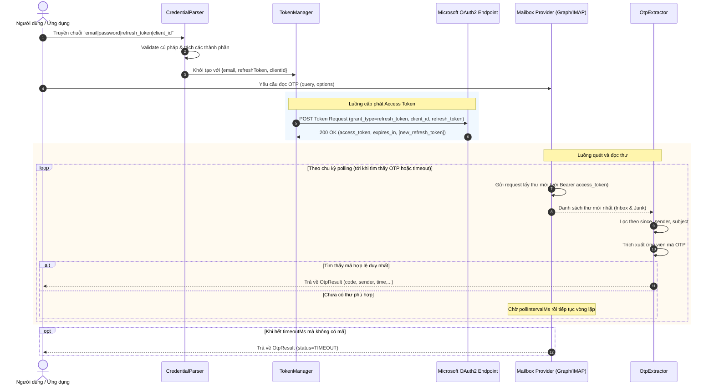

# Thiết kế SDK đọc Email & OTP từ Hotmail / Outlook qua OAuth2

## 1. Mục tiêu

Tài liệu này đặc tả kiến trúc và thiết kế kỹ thuật của SDK/công cụ truy vấn email và trích xuất mã OTP từ các tài khoản Hotmail/Outlook.

Hệ thống cho phép người dùng cung cấp thông tin tài khoản theo định dạng tiêu chuẩn:
```text
email|password|refresh_token|client_id
```

Từ thông tin đầu vào trên, SDK thực hiện:
1. Tự động phân tách và kiểm tra tính hợp lệ của chuỗi thông tin tài khoản.
2. Sử dụng `refresh_token` và `client_id` để yêu cầu cấp mới `access_token` thông qua Microsoft Identity / OAuth2 token endpoint mà không cần người dùng can thiệp thủ công qua trình duyệt.
3. Sử dụng `access_token` để kết nối vào mailbox (ưu tiên **Microsoft Graph API**, hỗ trợ dự phòng **IMAP qua OAuth2/XOAUTH2**) nhằm quét và đọc các thư mới nhất (Inbox, Junk/Spam).
4. Phân tích nội dung email, áp dụng bộ lọc (thời gian `since`, người gửi, tiêu đề) và trích xuất mã OTP hoặc trả về kết quả đọc email theo yêu cầu.
5. Trả về kết quả rõ ràng, có cấu trúc kèm siêu dữ liệu cần thiết (mã OTP, người gửi, tiêu đề, thời điểm nhận, trạng thái).

> [!IMPORTANT]
> SDK phục vụ các mục đích kiểm thử hệ thống tự động, dịch vụ nội bộ hoặc quản trị mailbox mà người dùng sở hữu hoặc đã được ủy quyền hợp pháp.
> - **Kiểm thử tự động (Unit / CI tests):** Sử dụng 100% dữ liệu giả lập (synthetic data) và mock server trong mã nguồn kiểm thử và CI.
> - **Kiểm chứng chức năng thực tế (Live Functional Verification / Smoke Test):** Cho phép người dùng cung cấp thông tin hộp thư kiểm thử thực tế do chính mình sở hữu hoặc được ủy quyền đầy đủ để kiểm chứng khả năng kết nối, làm mới token và đọc thư/OTP thực tế từ máy chủ Microsoft.

---

## 2. Phạm vi và đặc tả định dạng đầu vào

### 2.1. Định dạng tài khoản người dùng cung cấp

Người dùng cung cấp thông tin tài khoản dưới dạng chuỗi có định dạng 4 trường ngăn cách bởi ký tự `|`:
```text
<email>|<password>|<refresh_token>|<client_id>
```

| Trường | Mô tả | Vai trò & Xử lý kỹ thuật |
|---|---|---|
| `email` | Địa chỉ email Hotmail/Outlook (ví dụ: `user@hotmail.com`). | Định danh tài khoản/mailbox mục tiêu, dùng cho Graph endpoint `me` và thông số User trong IMAP XOAUTH2. |
| `password` | Mật khẩu tài khoản email. | Thông tin dự phòng hoặc quản trị. **Lưu ý bảo mật:** Luồng làm mới token OAuth2 (`grant_type=refresh_token`) tuyệt đối không gửi trường này qua mạng và không lưu vào log. |
| `refresh_token` | OAuth2 Refresh Token dài hạn của Microsoft. | Dùng để gửi tới Microsoft OAuth2 token endpoint để đổi lấy `access_token` mới có quyền đọc mail. |
| `client_id` | Application (Client) ID đăng ký trên Azure/Microsoft Identity. | Định danh ứng dụng khách tương ứng đã được cấp quyền mailbox (ví dụ: Azure App ID hoặc Live SDK Client ID). |

### 2.2. Hỗ trợ phương thức nạp dữ liệu
- **Đơn lẻ (Single):** Nhận 1 chuỗi `email|password|refresh_token|client_id`.
- **Hàng loạt (Batch/List):** Nhận danh sách các chuỗi hoặc đọc từ file văn bản (.txt) với mỗi dòng là 1 tài khoản.
- **Đối tượng có kiểu (Strongly Typed Object):** `HotmailAccount` struct / class tương thích trong từng ngôn ngữ lập trình.

### 2.3. Xử lý chuỗi chứa trường mở rộng
Trong thực tế, người dùng có thể cung cấp chuỗi xuất tài khoản chứa các trường bổ sung bên cạnh 4 trường cơ bản (ví dụ: `email|password|refresh_token|client_id|recovery_email|cookies`).
- SDK định danh và ưu tiên bóc tách 4 trường đầu tiên (`email`, `password`, `refresh_token`, `client_id`) phục vụ luồng kết nối Microsoft OAuth2 và đọc thư.
- Các trường bổ sung (từ trường thứ 5 trở đi) không thuộc phạm vi đọc mail Hotmail sẽ được bỏ qua an toàn hoặc cảnh báo làm sạch để không gây gián đoạn quy trình phân tích cú pháp.

---

## 3. Quyết định kiến trúc

1. **Cơ chế xác thực không tương tác (Headless Token Refresh):**
   - Tận dụng `client_id` và `refresh_token` để tự động lấy `access_token` hợp lệ trong nền (headless), không yêu cầu mở trình duyệt hay phiên tương tác GUI/MFA tại mỗi lần đọc mail.
   - Tự động gia hạn và tái sử dụng `access_token` trong khoảng thời gian còn hiệu lực (`expires_in`) để giảm thiểu số lượng HTTP request đến máy chủ Microsoft.

2. **Backend mặc định và dự phòng:**
   - **Microsoft Graph API (Default):** Backend chính hiện đại, hỗ trợ truy vấn lọc mạnh mẽ qua OData query (`$filter`, `$orderby`, `$select`), phân trang và bắt lỗi phân loại rõ ràng.
   - **IMAP qua OAuth2 / XOAUTH2 (Optional/Fallback):** Backend phụ khi môi trường cần giao thức mail truyền thống hoặc tenant/scope được cấp quyền qua IMAP (`outlook.office.com:993`).

3. **Phân tách trách nhiệm rõ ràng (Separation of Concerns):**
   - `CredentialParser`: Phân tích và thẩm định chuỗi tài khoản `email|password|refresh_token|client_id`.
   - `TokenManager`: Chuyên trách giao tiếp Microsoft OAuth2 endpoint để refresh token và quản lý vòng đời token.
   - `MailboxProvider`: Đọc và truy vấn thư (Graph / IMAP).
   - `OtpExtractor`: Chuẩn hóa nội dung (HTML/Text) và bóc tách OTP theo biểu thức chính quy (Regex) và bộ lọc nghiệp vụ.

---

## 4. Kiến trúc logic

```text
Chuỗi đầu vào (email|password|refresh_token|client_id)
      │
      ▼
┌──────────────────────────┐
│     CredentialParser     │ ── Thẩm định cú pháp & tách 4 trường
└─────────────┬────────────┘
              │ HotmailAccount
              ▼
┌──────────────────────────┐
│       TokenManager       │ ── Gửi refresh_token + client_id
└─────────────┬────────────┘    tới Microsoft Token Endpoint
              │
              ├─► Trả về: access_token hợp lệ
              ▼
┌──────────────────────────┐
│      MailboxClient       │ (Điều phối bởi OtpReader / MailReader)
│  ┌────────────────────┐  │
│  │   Graph Provider   │──┼──► Microsoft Graph API (me/messages)
│  └────────────────────┘  │
│  ┌────────────────────┐  │
│  │   IMAP Provider    │──┼──► IMAP outlook.office365.com + XOAUTH2
│  └────────────────────┘  │
└─────────────┬────────────┘
              │ Danh sách email thô (raw messages)
              ▼
┌──────────────────────────┐
│    MessageNormalizer     │ ── Chuẩn hóa text, thời gian UTC, người gửi
└─────────────┬────────────┘
              │
              ▼
┌──────────────────────────┐
│       OtpExtractor       │ ── Áp dụng bộ lọc since, sender, pattern OTP
└─────────────┬────────────┘
              │
              ▼
    Kết quả: OtpResult / MailResult
```

### Chi tiết trách nhiệm các thành phần

| Thành phần | Trách nhiệm |
|---|---|
| `CredentialParser` | Parse định dạng `email|password|refresh_token|client_id`; kiểm tra định dạng email và các trường bắt buộc; loại bỏ khoảng trắng thừa. |
| `TokenManager` | Gọi Microsoft OAuth2 Token endpoint; quản lý bộ nhớ đệm `access_token`; tự động refresh khi token hết hạn; bảo vệ token trong RAM. |
| `MailboxProvider` | Hợp đồng chung đọc email; triển khai cho Microsoft Graph và IMAP. |
| `MessageNormalizer` | Bóc tách HTML sang Plain Text thuần túy, xử lý bảng mã Unicode, chuẩn hóa thời gian về ISO 8601 UTC. |
| `OtpExtractor` | Lọc email theo mốc thời gian `since`, allowlist người gửi, trích xuất mã OTP qua regex thông minh (4-8 số hoặc chữ số). |
| `OtpReader` | Lớp API cao nhất (Facade), cung cấp hàm gọi đơn giản cho người dùng (ví dụ: `readOtp()`, `readLatestMails()`). |

---

## 5. Hợp đồng API khái niệm

```text
// Cấu trúc tài khoản giải mã từ chuỗi đầu vào
HotmailAccount {
  email: string
  password: string            // Được bảo vệ, không log
  refreshToken: string        // Dùng để refresh access token
  clientId: string            // Azure/Live Client ID
}

// Cấu hình truy vấn đọc thư / OTP
OtpQuery {
  since?: timestamp           // Mốc thời gian thư tối thiểu (khuyến nghị bắt buộc khi chờ OTP)
  senderAllowlist?: string[]  // Danh sách email/miền người gửi tin cậy (vd: "no-reply@service.com")
  subjectContains?: string    // Từ khóa tiêu đề cần tìm
  otpPattern?: regex          // Mẫu regex nhận diện OTP (mặc định tìm 4-8 chữ số liên tiếp)
  folder?: string             // Thư mục cần quét: "Inbox" (mặc định), "Junk", hoặc cả hai
}

// Tùy chọn thực thi
OtpOptions {
  timeoutMs: number           // Thời gian chờ tối đa (ví dụ: 60000ms)
  pollIntervalMs: number      // Khoảng cách giữa các lần quét (ví dụ: 3000ms - 5000ms)
  maxMessagesToCheck: number  // Số lượng thư mới nhất cần kiểm tra mỗi lần quét (ví dụ: 5 - 10)
  includeBodySnippet: boolean // Có đính kèm trích đoạn nội dung thư vào kết quả hay không
}

// Kết quả trả về cho người dùng
OtpResult {
  status: "SUCCESS" | "TIMEOUT" | "AMBIGUOUS" | "ERROR"
  email: string               // Mailbox đã đọc
  code?: string               // Mã OTP trích xuất thành công (vd: "482910")
  messageId?: string          // ID của bức thư trên server
  receivedAt?: timestamp      // Thời điểm máy chủ nhận thư (UTC)
  sender?: string             // Địa chỉ người gửi
  subject?: string            // Tiêu đề email
  bodySnippet?: string        // Trích đoạn nội dung thư an toàn
  provider: "GRAPH" | "IMAP"  // Backend đã thực thi
  error?: string              // Chi tiết lỗi nếu thất bại
}

// Kết quả trả về khi người dùng muốn đọc toàn bộ nội dung thư (MailResult)
MailResult {
  messageId: string
  receivedAt: timestamp
  sender: string
  subject: string
  bodyText: string            // Toàn văn nội dung thư đã chuẩn hóa dạng văn bản
  bodyHtml?: string           // Nội dung HTML gốc (nếu yêu cầu)
}

// Interface chính của SDK
OtpReader {
  // Khởi tạo từ chuỗi định dạng email|password|refresh_token|client_id
  static fromFormat(accountLine: string, options?: ConfigOptions) -> OtpReader

  // Đọc và chờ OTP mới xuất hiện theo tiêu chí
  waitForOtp(query: OtpQuery, options?: OtpOptions) -> OtpResult

  // Đọc danh sách thư mới nhất mà không chờ OTP
  getLatestMessages(top?: number, folder?: string) -> List<MailResult>

  // Đóng phiên kết nối và giải phóng tài nguyên
  close() -> void
}
```

---

## 6. Luồng xử lý chi tiết



### Các bước thực hiện:
1. **Tiếp nhận và thẩm định:** Nhận chuỗi `email|password|refresh_token|client_id`, kiểm tra đủ 4 trường và tính hợp lệ cơ bản của email và token.
2. **Làm mới token:** Sử dụng `client_id` và `refresh_token` gửi yêu cầu POST đến Microsoft token endpoint để nhận `access_token`.
3. **Thiết lập kết nối mailbox:** Đưa `access_token` vào header `Authorization: Bearer <access_token>` (đối với Graph API) hoặc cơ chế SASL XOAUTH2 (đối với IMAP).
4. **Truy vấn danh sách email:**
   - Ưu tiên gọi Microsoft Graph endpoint `GET /v1.0/me/mailFolders/inbox/messages?$top=10&$orderby=receivedDateTime desc`.
   - Nếu được cấu hình hoặc khi cần thiết, quét thêm thư mục `junkemail`.
5. **Chuẩn hóa & Lọc:**
   - Bỏ qua các thư nhận trước mốc thời gian `since`.
   - Lọc theo địa chỉ người gửi tin cậy (`senderAllowlist`) nếu có.
   - Chuyển đổi nội dung HTML của thư sang dạng Text sạch sẽ.
6. **Trích xuất OTP:** Áp dụng regex tìm mã xác minh (ví dụ: `\b\d{4,8}\b`). Nếu có nhiều mã gây mơ hồ, phân tích ngữ cảnh từ khóa (ví dụ: "mã xác nhận", "verification code", "OTP", "is:").
7. **Trả kết quả:** Đóng gói thông tin vào `OtpResult` hoặc `MailResult` và trả về cho người gọi.

---

## 7. Chi tiết kỹ thuật Microsoft OAuth2 & Backend

### 7.1. Làm mới token qua Refresh Token

- **Token Endpoint:**
  - Cá nhân/Live: `https://login.live.com/oauth20_token.srf`
  - Hoặc Microsoft Identity v2.0: `https://login.microsoftonline.com/common/oauth2/v2.0/token` (hoặc `/consumers/oauth2/v2.0/token`)
- **HTTP Method:** `POST`
- **Content-Type:** `application/x-www-form-urlencoded`
- **Body parameters:**
  ```text
  client_id=<client_id>
  grant_type=refresh_token
  refresh_token=<refresh_token>
  scope=https://graph.microsoft.com/Mail.Read offline_access
  ```
- **Xử lý phản hồi:**
  - Lưu `access_token` vào bộ nhớ kèm thời gian hết hạn (`expires_in`, thường là 3600 giây).
  - Nếu phản hồi trả về `refresh_token` mới (cơ chế token rolling), SDK cập nhật lại `refresh_token` hiện hành.

### 7.2. Backend Microsoft Graph API (Chính)

- **Endpoint đọc thư:**
  - Hộp thư đến: `https://graph.microsoft.com/v1.0/me/mailFolders/inbox/messages`
  - Thư rác: `https://graph.microsoft.com/v1.0/me/mailFolders/junkemail/messages`
- **Header:**
  - `Authorization: Bearer <access_token>`
  - `Accept: application/json`
- **OData Query Parameters tối ưu:**
  - `$select=id,receivedDateTime,from,subject,bodyPreview,body`
  - `$orderby=receivedDateTime desc`
  - `$top=5`

### 7.3. Backend IMAP qua OAuth2 (Dự phòng)

- **Máy chủ IMAP:** `outlook.office365.com`, cổng `993` (SSL/TLS).
- **Xác thực:** SASL `XOAUTH2`.
- **Chuỗi cấu trúc XOAUTH2:**
  ```text
  user=<email>^Aauth=Bearer <access_token>^A^A
  ```
  *(trong đó `^A` biểu diễn byte điều khiển `\x01`, toàn bộ chuỗi được mã hóa Base64 trước khi gửi)*.
- **Thao tác đọc:** Lệnh `SELECT INBOX`, tìm kiếm `UID SEARCH UNSEEN` hoặc sắp xếp theo `INTERNALDATE`, lấy nội dung qua `UID FETCH <UID> (BODY.PEEK[])`.

---

## 8. Độ chính xác khi nhận diện OTP

1. **Bộ lọc thời gian (`since`):** Khuyến nghị người dùng truyền thời điểm bắt đầu thao tác yêu cầu gửi OTP; SDK loại bỏ mọi thư đến trước mốc này để tránh nhầm với mã cũ đã hết hạn.
2. **Allowlist người gửi:** Cấu hình danh sách domain/email được phép (ví dụ: `@facebookmail.com`, `no-reply@accounts.google.com`, `account-security-noreply@accountprotection.microsoft.com`).
3. **Phân tích ngữ cảnh nội dung đa ngôn ngữ (Multi-language Context Scoring):**
   - Hỗ trợ nhận diện tự động từ khóa xác thực đa ngôn ngữ:
     - **Tiếng Anh:** `verification code`, `otp`, `passcode`, `security code`, `one-time password`, `confirmation code`, `access code`
     - **Tiếng Việt:** `mã xác nhận`, `mã xác minh`, `mã xác thực`, `mã otp`, `mã bảo mật`, `mã đăng nhập`, `mã kích hoạt`
     - **Tiếng Trung (Giản thể & Phồn thể):** `验证码`, `驗證碼`, `校验码`, `确认码`, `安全码`, `动态码`, `一次性密码`
     - **Tiếng Nhật:** `認証コード`, `確認コード`, `セキュリティコード`, `ワンタイムパスワード`, `ログインコード`
     - **Tiếng Hàn:** `인증코드`, `인증번호`, `확인코드`, `보안코드`
     - **Tiếng Nga:** `код подтверждения`, `проверочный код`, `код безопасности`, `одноразовый пароль`
     - **Tiếng Tây Ban Nha / Bồ Đào Nha / Pháp / Đức / Ý:** `código de verificación`, `code de sécurité`, `bestätigungscode`, `codice di verifica`
     - **Tiếng Indonesia / Thái:** `kode verifikasi`, `รหัสยืนยัน`
   - Nhận diện chuẩn xác biên độ chữ số `(?<![0-9a-zA-Z])\d{4,8}(?![0-9a-zA-Z])` ngay cả khi dính liền với ký tự CJK không có khoảng trắng (ví dụ: `您的验证码是482910`).
   - Loại trừ các số không phải OTP: số điện thoại, mã bưu điện, mã tra cứu đơn hàng, năm (ví dụ `2026`).
4. **Xử lý tình huống mơ hồ (Ambiguous):** Nếu trong một email hoặc nhiều email mới xuất hiện đồng thời nhiều mã hợp lệ mà không phân định được độ ưu tiên, trả về trạng thái `AMBIGUOUS` kèm danh sách ứng viên thay vì chọn ngẫu nhiên.

---

## 9. Hiệu năng, Độ tin cậy và Giới hạn truy vấn

- **Cơ chế Polling thông minh:**
  - Quét theo chu kỳ mặc định: 3 - 5 giây/lần.
  - Áp dụng Exponential Backoff có Jitter khi gặp mã lỗi `429 (Too Many Requests)` hoặc lỗi tạm thời `5xx`.
  - Tôn trọng header `Retry-After` từ máy chủ Microsoft.
- **Quản lý Timeout:** Đặt timeout tổng thể (mặc định 60 giây). Khi quá hạn, ngắt vòng lặp polling và trả lỗi `Timeout` nhanh chóng, không treo luồng ứng dụng.
- **Hạn chế tải dữ liệu:** Chỉ truy vấn các trường tối thiểu cần thiết (`$select`), không tải file đính kèm lớn (attachments) để tiết kiệm băng thông và tăng tốc độ xử lý.

---

## 10. Bảo mật và Quyền riêng tư

> [!CAUTION]
> Chuỗi thông tin tài khoản chứa mật khẩu và refresh token là dữ liệu nhạy cảm cao cấp. Mọi thành phần trong hệ thống phải tuân thủ nghiêm ngặt các quy định sau:

1. **Không log dữ liệu nhạy cảm:**
   - Tuyệt đối không in toàn bộ chuỗi `email|password|refresh_token|client_id` ra console, file log hoặc hệ thống giám sát.
   - Che giấu (`mask`) mật khẩu và token khi cần hiển thị (ví dụ: `pass***`, `0.AXA...***`).
2. **Nguyên tắc tối thiểu đối với Mật khẩu:**
   - Mật khẩu (`password`) không được dùng trong request lấy `access_token` qua OAuth2.
   - Không lưu trữ mật khẩu ở trạng thái plain text trên đĩa.
3. **Bảo vệ Token trong bộ nhớ:** `access_token` chỉ tồn tại trong RAM phục vụ phiên làm việc; tự động xóa khi kết thúc tác vụ hoặc gọi `close()`.
4. **Bảo mật kết nối:** Toàn bộ giao tiếp mạng bắt buộc thực hiện qua HTTPS/TLS 1.2+ với chứng chỉ hợp lệ.
5. **Quy chuẩn dữ liệu kiểm thử & Kiểm chứng thực tế:**
   - **Kiểm thử tự động (Unit / CI tests):** Tuyệt đối không dùng thông tin tài khoản thật trong mã nguồn kiểm thử tự động, test fixtures hoặc commit vào git; toàn bộ unit test và kiểm thử hồi quy bắt buộc dùng dữ liệu giả lập (synthetic credentials) và mock server.
   - **Kiểm chứng chức năng với Hộp thư kiểm thử do người dùng cung cấp (Authorized Test Mailbox):**
     + Người dùng được phép cung cấp thông tin hộp thư Hotmail kiểm thử thực tế do chính mình sở hữu hoặc được ủy quyền hợp pháp để kiểm chứng chức năng đọc thư và trích xuất OTP thực tế.
     + Toàn bộ thông tin nhạy cảm (mật khẩu, refresh token) chỉ được nạp và xử lý tạm thời trong bộ nhớ RAM trong suốt phiên kiểm chứng, không được ghi vào file log hay lưu trữ lâu dài.
     + Hệ thống luôn tự động che giấu (`masking`) địa chỉ email và token trong mọi log và kết quả console.

---

## 11. Bảng mã lỗi công khai

| Mã lỗi | Ý nghĩa | Hành động khắc phục |
|---|---|---|
| `InvalidCredentialFormat` | Chuỗi đầu vào không đúng định dạng 4 trường `email\|password\|refresh_token\|client_id`. | Kiểm tra lại định dạng chuỗi cung cấp. |
| `TokenRefreshFailed` | Không lấy được `access_token` từ Microsoft (sai `client_id`, `refresh_token` hết hạn hoặc bị thu hồi). | Cấp lại `refresh_token` mới từ tài khoản hoặc kiểm tra lại `client_id`. |
| `AccountLockedOrDisabled` | Tài khoản Hotmail bị khóa hoặc tạm khóa bởi Microsoft. | Mở khóa tài khoản thủ công qua giao diện web. |
| `MailboxProviderError` | Lỗi kết nối tới Microsoft Graph API hoặc máy chủ IMAP. | Kiểm tra kết nối mạng hoặc thử lại với backend dự phòng. |
| `Throttled` | Bị Microsoft giới hạn tốc độ truy vấn (HTTP 429). | Chờ theo thời gian `Retry-After` trước khi thử lại. |
| `Timeout` | Đã hết thời gian chờ (`timeoutMs`) mà không có thư hoặc OTP mới phù hợp. | Tăng thời gian timeout hoặc yêu cầu hệ thống đích gửi lại mã. |
| `AmbiguousOtp` | Tìm thấy nhiều mã OTP trong thư nhưng không phân giải được mã chính xác. | Siết chặt bộ lọc người gửi, tiêu đề hoặc cung cấp regex đặc thù. |
| `OtpNotFound` | Đọc được email mới nhưng không trích xuất được chuỗi số phù hợp quy tắc OTP. | Kiểm tra lại mẫu email hoặc định dạng OTP của dịch vụ gửi. |
| `InvalidOtpPattern` | Biểu thức chính quy `otpPattern` do người dùng cung cấp không hợp lệ. | Sửa lại cú pháp regex trong `OtpQuery`. |

---

## 12. Chiến lược kiểm thử

1. **Unit Tests:**
   - Thẩm định parser định dạng `email|password|refresh_token|client_id` (trường hợp đủ trường, thiếu trường, có ký tự đặc biệt, khoảng trắng thừa, hoặc trường mở rộng).
   - Kiểm tra bóc tách OTP với các mẫu email thực tế giả lập (Facebook, Google, TikTok, Telegram, ngân hàng,...).
   - Kiểm tra bộ lọc thời gian `since` và allowlist người gửi.
2. **Mock Integration Tests:**
   - Giả lập (Mock) máy chủ Microsoft OAuth2 token endpoint để kiểm tra luồng đổi token thành công, hết hạn và lỗi 400/401.
   - Giả lập Mock Graph API và Mock IMAP server để kiểm tra phân trang, lỗi 429 throttling và timeout.
3. **Kiểm tra an toàn bảo mật (Security Audit Tests):**
   - Rà soát toàn bộ log đầu ra để xác nhận không có mật khẩu hay refresh token bị rò rỉ.
   - Đảm bảo mã nguồn và fixture không chứa thông tin tài khoản thật.
4. **Kiểm chứng chức năng thực tế với Hộp thư kiểm thử do người dùng cung cấp (Live Functional Verification):**
   - **Mục đích:** Xác nhận SDK hoạt động chính xác với hạ tầng thực tế của Microsoft Identity, Graph API và IMAP server.
   - **Điều kiện:** Hộp thư kiểm thử thuộc quyền sở hữu hoặc được ủy quyền rõ ràng bởi người dùng.
   - **Phương thức thực hiện an toàn:**
     + Người dùng truyền thông tin tài khoản qua biến môi trường (`HOTMAIL_OTP_ACCOUNT`) hoặc file cục bộ (`--account-file`):
       ```powershell
       # Thiết lập biến môi trường cho tài khoản kiểm thử
       $env:HOTMAIL_OTP_ACCOUNT = "email|password|refresh_token|client_id"

       # Chạy kiểm chứng danh sách email mới nhất
       hotmail-otp list --top 5 --folder both

       # Hoặc chạy kiểm chứng chờ mã OTP
       python examples/wait_for_otp.py
       ```
     + SDK thực hiện làm mới token với Microsoft, truy vấn danh sách email mới nhất và hiển thị tiêu đề, người gửi, thời gian thư hoặc mã OTP.
     + Kết thúc kiểm chứng: Đóng phiên (`close()`), tự động giải phóng token khỏi RAM, không ghi log mật khẩu/token.

---

## 13. Tiêu chí nghiệm thu

- [x] Tài liệu mô tả đầy đủ và rõ ràng quy trình nhận đầu vào `email|password|refresh_token|client_id`.
- [x] Quy trình làm mới `access_token` qua OAuth2 được đặc tả chi tiết với endpoint và tham số chính xác.
- [x] Cung cấp hợp đồng API rõ ràng cho cả 2 thao tác: đọc mã OTP (`waitForOtp`) và đọc danh sách email (`getLatestMessages`).
- [x] Có đầy đủ cơ chế lọc theo thời gian, người gửi, tiêu đề và xử lý mã mơ hồ.
- [x] Tuân thủ các nguyên tắc bảo vệ dữ liệu nhạy cảm, che giấu mật khẩu/token và xử lý lỗi chuẩn mực.
- [x] Cho phép và hướng dẫn quy chuẩn kiểm chứng chức năng thực tế (Smoke Test / E2E) với hộp thư kiểm thử do người dùng sở hữu và cung cấp.
